# Detecting Pneumonia in Children's Chest X-rays: Four Ways to Build a Classifier

A course project (CSC 211H5) that asks one question four different ways:

> **Given one chest X-ray of a child, is it PNEUMONIA or NORMAL?**

The same 624 test images are answered by **a person**, by **a hand-written rule**, by **a neural network**, and (planned) by **a large language model**. Every approach is scored by the same script with the same metrics, so the comparison is fair. The repository is as much about *why each design choice was made* as about the final numbers, so most sections link to the evidence behind a decision.

**This is a learning project, not a medical device.** Nothing here should be used to make a clinical decision.

---

## Contents

1. [The result in one page](#1-the-result-in-one-page)
2. [The problem in plain language](#2-the-problem-in-plain-language)
3. [The data](#3-the-data)
4. [How success is measured](#4-how-success-is-measured)
5. [The four approaches](#5-the-four-approaches)
6. [Results in detail](#6-results-in-detail)
7. [What the results mean, and what they do not](#7-what-the-results-mean-and-what-they-do-not)
8. [Repository map](#8-repository-map)
9. [How to reproduce everything](#9-how-to-reproduce-everything)
10. [Documentation index](#10-documentation-index)
11. [Status, known issues and credits](#11-status-known-issues-and-credits)

---

## 1. The result in one page

All numbers below are on the **full test set of 624 images** (390 pneumonia, 234 normal), measured once, after every design decision was frozen. "Positive" means PNEUMONIA.

| Approach | F1 | Recall (pneumonia caught) | Specificity (normals cleared) | Balanced accuracy | MCC |
|---|---|---|---|---|---|
| Always answer "pneumonia" (trivial baseline) | 0.769 | 1.000 | 0.000 | 0.500 | 0.000 |
| **Symbolic rule** (hand-written, no training) | 0.763 | 0.697 | 0.782 | 0.740 | 0.465 |
| **Deep learning** (pretrained MobileNetV2) | **0.908** | **0.977** | 0.709 | **0.843** | **0.740** |
| Human baseline | scored on a 40-image subset only, see [section 6](#6-results-in-detail) | | | | |

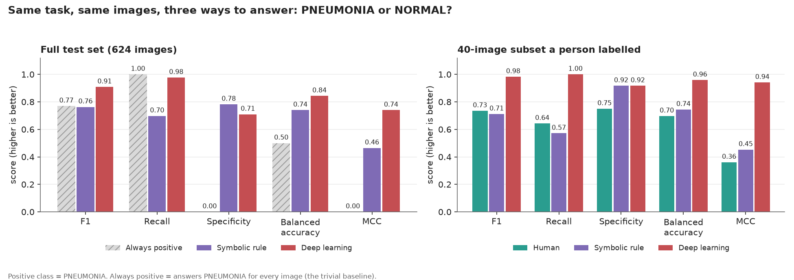

**Five things to take away**

1. **The neural network is clearly the best approach here.** Its F1 is 0.908 against the rule's 0.763, and the confidence intervals do not overlap (0.884 to 0.930 versus 0.725 to 0.798). It misses only 9 of 390 pneumonia cases.
2. **It pays for that with false alarms.** It wrongly flags 68 of 234 healthy children (29%). The hand-written rule is slightly better at clearing healthy children (22% false alarms), but the difference is within statistical noise.
3. **F1 alone is a trap.** A "classifier" that always says PNEUMONIA scores F1 0.769, which is *higher than the symbolic rule's 0.763*. That is why this project also reports specificity, balanced accuracy and MCC (all defined in [section 4](#4-how-success-is-measured)).
4. **The validation numbers were far too optimistic.** On the validation images the network scored an AUROC of about 0.99 and cleared about 97% of normals. On the test set those fell to 0.964 and 71%. The test set looks different from the data the model was tuned on ([section 7](#7-what-the-results-mean-and-what-they-do-not)).
5. **Pretraining helps when data is scarce, not when it is plentiful.** With 10% of the training data a pretrained network reaches validation AUROC 0.969, while a tiny network trained from scratch reaches 0.737. With all the data the scratch network catches up.

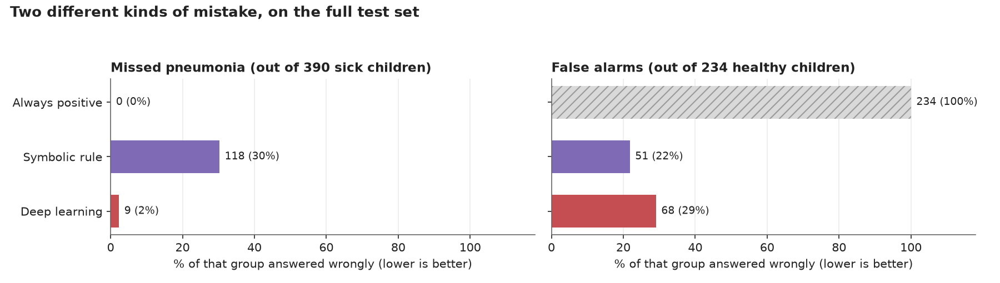

---

## 2. The problem in plain language

**Pneumonia** is a lung infection. In a chest X-ray, healthy lungs appear mostly dark (they are full of air) with thin lines for ribs and blood vessels. Infected lungs contain fluid and inflammation, which appear as hazy, whiter regions. It is a leading cause of death in young children worldwide (the WHO attributes about 14% of deaths of children under 5 in 2019 to it), and specialists who can read X-rays are scarce in many places. A tool that flags suspicious X-rays could help decide which ones to read first. It would *assist* a clinician, never replace one.

**The task.** The input is a single grayscale chest X-ray image. The output is one of two answers:

| Answer | Name used in the code | Meaning |
|---|---|---|
| PNEUMONIA | **Positive** | the image shows pneumonia |
| NORMAL | **Negative** | the image shows no pneumonia |

Nothing else is given to any approach: no age, no medical history, no file name. (File names in the dataset contain the words "bacteria" or "virus", which would reveal the answer, so they are never used as input.)

Here is what the model sees. Top rows: random NORMAL and PNEUMONIA training images. Bottom row: one pneumonia image and three random distortions of it that the network sees during training ("augmentation", explained in [section 5](#53-approach-3-deep-learning)).

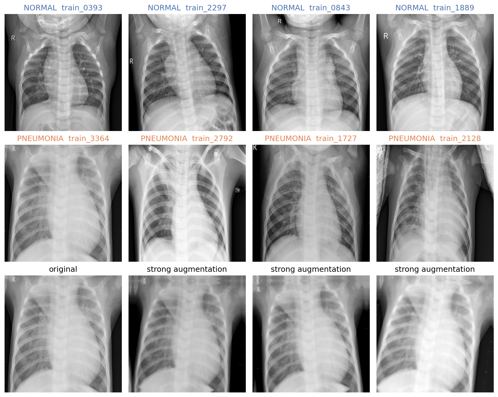

The difference between the classes is real but subtle. Pneumonia shows up as hazy whiter regions, but exposure, framing and the child's size vary a lot between images, which is why this is not a trivial task.

### Words used throughout

| Term | Meaning |
|---|---|
| **Positive / Negative** | PNEUMONIA / NORMAL. "Positive" is always the disease class. |
| **Train / validation / test** | *Train*: the images a model learns from. *Validation*: images held back to compare design choices (which model, which setting). *Test*: images used **once, at the very end**, to report the final score. Using test images to make choices would inflate the score, so this project guards against it in code. |
| **Threshold** | A model that outputs a probability needs a cut-off above which it answers "pneumonia". |
| **Overfitting** | A model memorises its training images and does worse on new ones. |
| **Transfer learning** | Start from a neural network already trained on a huge unrelated image collection (ImageNet) and adapt it, instead of starting from random numbers. |
| **Backbone** | The pretrained part of the network that turns an image into a list of numbers (features). |
| **Frozen** | Not changed during training. |
| **Grad-CAM** | A heat map showing which image regions pushed the network's answer towards "pneumonia". |

---

## 3. The data

**Source.** The Kaggle dataset *Chest X-Ray Images (Pneumonia)* (Paul Mooney), which comes from Kermany et al. (2018). According to its data card these are chest X-rays of children aged one to five from one hospital (Guangzhou Women and Children's Medical Center), taken during routine care. Low-quality scans were removed and physicians graded each diagnosis. The dataset page lists a CC BY 4.0 licence. The raw images are **not** stored in this repository (see [section 9](#9-how-to-reproduce-everything) for how to download them).

**Size.** 5,856 images in total. The images are very uneven in size: widths run from 384 to 2,916 pixels and heights from 127 to 2,713 (measured on this download), so every approach first rescales them.

### How the images are divided

One split is used by **every** approach. It is defined in one place, `data/image_index.csv`, column `split`, and nothing else ever splits the data.

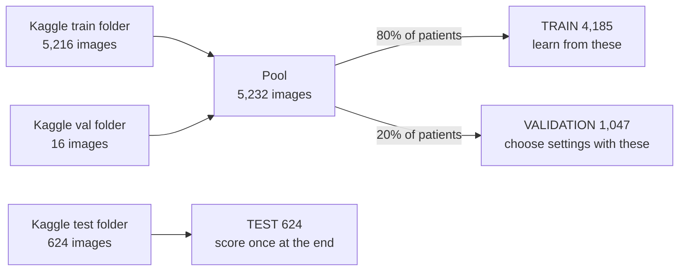

| Split | Images | Normal | Pneumonia | % pneumonia | Used for |
|---|---|---|---|---|---|
| Train | 4,185 | 1,079 | 3,106 | 74.2% | learning (neural network) and designing the rule |
| Validation | 1,047 | 270 | 777 | 74.2% | comparing settings, choosing the threshold |
| **Test** | **624** | **234** | **390** | **62.5%** | the final score, once |

Three details matter for everything that follows:

- **The split is by patient, not by image.** One child can have several X-rays. If one child's images landed on both sides, a model could "recognise the child" rather than the disease and look better than it is. Pneumonia file names carry a patient number (`person123_bacteria_456.jpeg`), so all images with the same number stay together. The code asserts that no patient appears in both train and validation.
- **Normal images have no patient number**, so each normal image is treated as its own group. This means one child's normal X-rays *could* sit on both sides of the train/validation split. It is a known limitation, recorded in [`data/data_checks.txt`](data/data_checks.txt).
- **The test set looks different from train and validation.** It has a lower share of pneumonia (62.5% versus 74%), and, as the later results show, its normal images are harder. Also, 170 pneumonia patient numbers appear in both the Kaggle train folder and the Kaggle test folder. The file names cannot show whether these are the same children or different children with the same number, so test scores for pneumonia could be slightly optimistic.

The class balance and pneumonia subtypes (bacterial or viral, readable only from file names and used only for the fairness analysis) in each split:

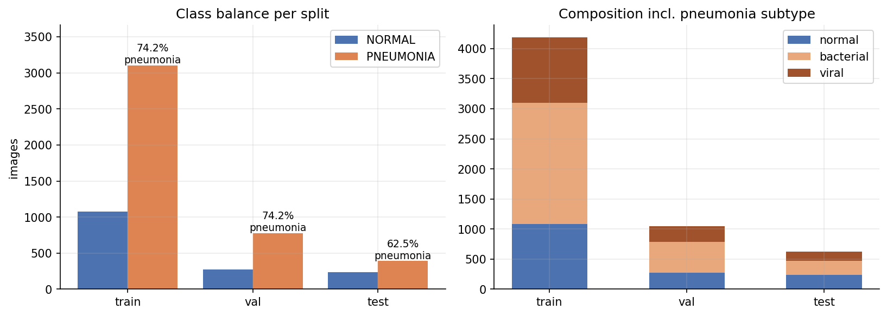

More detail, the column meanings of `image_index.csv`, and the checks that were run are in [`data/README.md`](data/README.md).

---

## 4. How success is measured

Every approach answers each test image with Positive or Negative. Comparing the answers with the truth gives four counts:

| | Model says PNEUMONIA | Model says NORMAL |
|---|---|---|
| **Truly pneumonia** | **TP** true positive (caught) | **FN** false negative (missed) |
| **Truly normal** | **FP** false positive (false alarm) | **TN** true negative (correctly cleared) |

The deep learning model's counts on the test set: **TP 381, FN 9, FP 68, TN 166**. From these:

| Metric | Formula | Worked example (deep learning) | Plain meaning |
|---|---|---|---|
| **Recall** (sensitivity) | TP / (TP + FN) | 381 / 390 = **0.977** | Of the sick children, how many were caught? A miss is the costly mistake in screening. |
| **Specificity** | TN / (TN + FP) | 166 / 234 = **0.709** | Of the healthy children, how many were correctly cleared? |
| **Precision** | TP / (TP + FP) | 381 / 449 = **0.849** | When it says pneumonia, how often is it right? |
| **F1** (primary metric) | 2·TP / (2·TP + FP + FN) | 762 / 839 = **0.908** | One number balancing recall and precision. |
| **Balanced accuracy** | (recall + specificity) / 2 | (0.977 + 0.709) / 2 = **0.843** | Accuracy that is not fooled by unequal class sizes. |
| **MCC** | a correlation between answers and truth | **0.740** | -1 to +1; 0 means no better than chance. |

**Why F1 is the primary metric, and why it is not enough.** Accuracy is misleading because 62.5% of the test images are pneumonia, so "always pneumonia" is already 62.5% accurate. F1 with pneumonia as the positive class balances catching pneumonia against false alarms, but "always pneumonia" still reaches F1 0.769, because F1 ignores true negatives. So the project reports specificity, balanced accuracy and MCC beside it; for the trivial baseline those are 0.000, 0.500 and 0.000, which exposes it immediately.

**Extra metrics for the neural network only** (it outputs a probability, the others give only yes/no): **AUROC** (the chance that a random sick image gets a higher score than a random healthy one; 0.5 is guessing, 1.0 is perfect), AUPRC, the **Brier score** and **expected calibration error** (do "90% sure" answers turn out right 90% of the time?).

**Confidence intervals.** A score from 624 images is an estimate, not an exact value. The project reports 95% intervals from a bootstrap: it repeatedly resamples *patients* (not single images, because one child can have several images) with replacement, recomputes the metric each time, and keeps the middle 95% of the results. If two intervals overlap heavily the difference cannot be trusted.

---

## 5. The four approaches

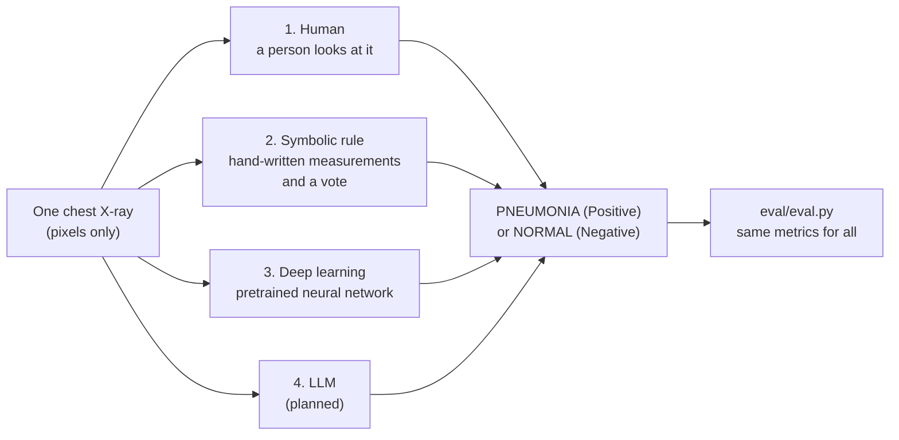

| # | Approach | Learns from labelled data? | Explains its answer? | Status |
|---|---|---|---|---|
| 1 | Human baseline | no (a person, no radiology training) | partly (the person can say why) | done, 40 images |
| 2 | Symbolic rule | no (thresholds set on training data, nothing is "trained") | yes, exactly | done, full test set |
| 3 | Deep learning | yes | only approximately (Grad-CAM) | done, full test set |
| 4 | LLM | no | to be determined | **not started** (`approaches/4_llm/` does not exist yet) |

### 5.1 Approach 1: Human baseline

*Purpose: how well does a motivated non-expert do, so the machine approaches have something to be compared with?*

- A random sample of **40 test images** (seed 211; 28 pneumonia, 12 normal) was labelled by the author, who has no radiology training.
- The images were shown in a small browser tool ([`labeller.html`](approaches/1_human_baseline/labeller.html)) with each image renamed to its example ID, so no file name, age or label was visible. There was no timer and no notes.
- Result: 27 of 40 correct (accuracy 0.675). Recall 0.643, specificity 0.750, F1 0.735. It missed 10 pneumonia cases and raised 3 false alarms.

Only 40 images were labelled, so one image moves accuracy by 2.5 points. The human result is a rough reference, not a precise one. Details: [`approaches/1_human_baseline/README.md`](approaches/1_human_baseline/README.md).

### 5.2 Approach 2: Symbolic rule (no machine learning)

*Purpose: how far can simple, explainable, hand-written image measurements get?*

The rule never learns from labels. A person chose three measurements, looked at the training images to pick a cut-off for each, and fixed the rule before it ever saw the test set.

1. **Normalise the picture**: crop away black borders, resize to 256×256, stretch brightness so that the 2nd to 98th percentile maps to 0 to 1 (this cancels differences in exposure).
2. **Look only at the lungs**: two fixed boxes covering roughly where the lungs sit (15–42% and 58–85% of the width, 27–74% of the height).
3. **Take three measurements** in those boxes and let each vote:

| Measurement | How it is computed | Votes "pneumonia" when | Why |
|---|---|---|---|
| Edge density | share of pixels flagged by the Canny edge detector | below 0.24 | hazy lungs have fewer sharp edges |
| Fine detail | spread of (image minus a blurred copy) | below 0.08 | less fine rib/vessel contrast |
| Brightness | average pixel value | above 0.60 | pneumonia looks whiter |

4. **Decide**: answer PNEUMONIA when **at least 2 of the 3** measurements vote for it.

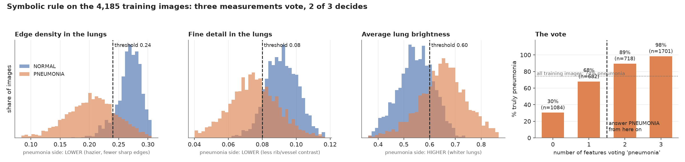

*Left three panels: the orange (pneumonia) and blue (normal) piles overlap, but each measurement leans a clear way; the dashed line is the cut-off. Right panel: the more measurements vote "pneumonia", the more likely the image truly shows it (30% with 0 votes, 98% with 3). All figures are from training images only.*

**Result on the test set:** F1 0.763, recall 0.697, specificity 0.782 (TP 272, FP 51, FN 118, TN 183). It misses 30% of the pneumonia cases. Many missed cases have lungs as dark and finely textured as healthy ones, so a whole-lung average misses patchy disease.

Details and the evidence for each choice: [`approaches/2_symbolic/README.md`](approaches/2_symbolic/README.md).

### 5.3 Approach 3: Deep learning

*Purpose: how well does a standard modern image classifier do, and what does it cost?*

A **neural network** is a function with millions of adjustable numbers that learns by repeatedly guessing, measuring its error and nudging the numbers. Training one from nothing needs a lot of images, so this project uses **transfer learning**: it takes **MobileNetV2**, already trained on ImageNet (a collection of ordinary photographs), keeps its image-understanding layers frozen, and trains only a tiny new "decision layer" on top.

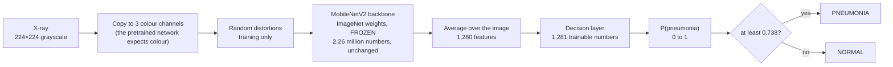

**Training recipe.** Class weights make the rarer NORMAL class count about 2.9 times more, so the model cannot win by always saying "pneumonia". Mild random rotation, zoom, shift, brightness and contrast changes are applied during training only. No horizontal flipping (the heart sits on one side of the chest). Optimiser AdamW with a cosine-decaying learning rate. Training ran 43 epochs (3 for the decision layer alone, 40 more), and the weights from the epoch with the best validation AUROC were kept (epoch 35).

**How the design was chosen.** The settings were found by a staged search, scored on validation only:

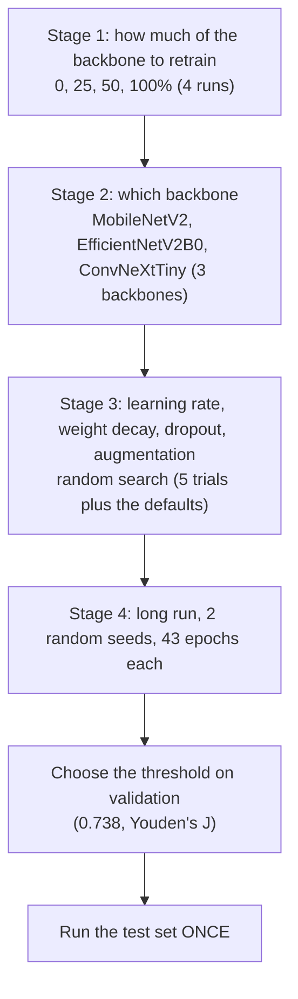

The surprising outcome: **retraining more of the network barely mattered**, so the simplest option won. Validation AUROC rose from 0.9908 (head only) to 0.9992 (everything unfrozen) in stage 1, but a difference under 0.01 on about 1,000 validation images is treated as noise and ties go to the smaller, cheaper model. The final model therefore trains **1,281 numbers**, yet reaches an AUROC of 0.964 on the test set.

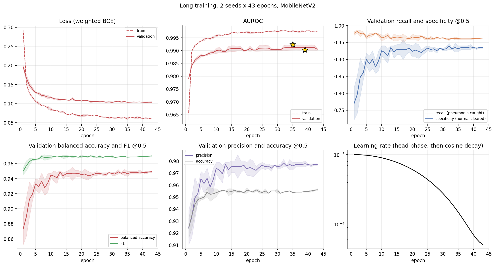

*Dashed = training, solid = validation. The curves flatten after about 12 epochs; the stars mark the best epoch of each of the two seeds. Note: this figure and figure 07 were produced before a notebook fix that puts training and validation loss on the same scale, so their loss panels overstate the train/validation gap; the AUROC, recall and specificity panels are unaffected (see [section 11](#11-status-known-issues-and-credits)).*

**Result on the test set:** F1 0.908, recall 0.977, specificity 0.709, AUROC 0.964.

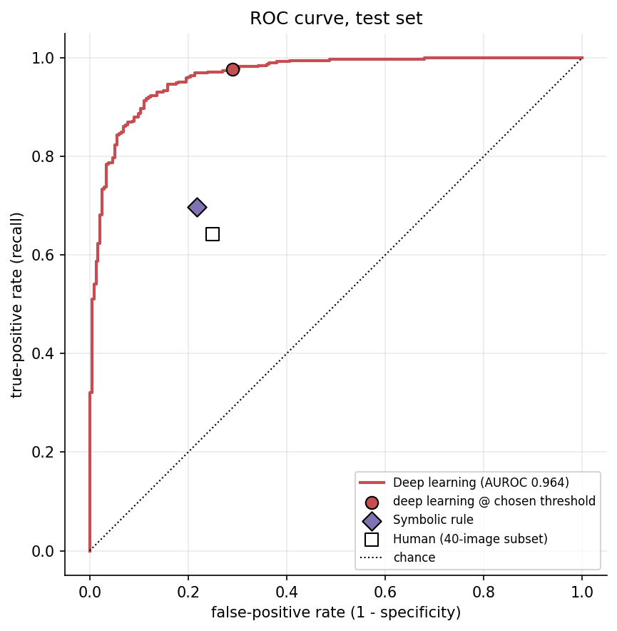

*The red curve shows the network's trade-off as the threshold moves; the dot is the chosen operating point. The symbolic rule (purple diamond) and the human (square, 40-image subset only) give only yes/no answers, so they are single points. Both sit well below the curve: at the same false-alarm rate the network would catch far more pneumonia.*

Details and every experiment table: [`approaches/3_deep_learning/README.md`](approaches/3_deep_learning/README.md) and [`docs/results-and-limitations.md`](docs/results-and-limitations.md).

### 5.4 Approach 4: LLM

Planned but **not implemented**. When added it will live in `approaches/4_llm/`, write `eval/predictions/llm_eval.csv`, and be scored by the same `eval/eval.py`.

---

## 6. Results in detail

### Full test set (n = 624)

| | Symbolic rule | Deep learning | Deep learning 95% interval |
|---|---|---|---|
| F1 | 0.763 | **0.908** | 0.884 to 0.930 |
| Recall | 0.697 | **0.977** | 0.960 to 0.991 |
| Specificity | **0.782** | 0.709 | 0.650 to 0.769 |
| Precision | 0.842 | 0.849 | 0.809 to 0.884 |
| Balanced accuracy | 0.740 | **0.843** | 0.810 to 0.873 |
| MCC | 0.465 | **0.740** | 0.686 to 0.792 |
| AUROC | n/a | 0.964 | 0.949 to 0.977 |

The intervals for recall, F1 and MCC do not overlap between the two approaches, so those differences are real. The intervals for specificity overlap (rule: 0.731 to 0.834), so the rule's small advantage there is not established.

### The 40-image subset that a person also labelled

| Approach | Correct | F1 | Recall | Specificity |
|---|---|---|---|---|
| Human | 27 / 40 | 0.735 | 0.643 | 0.750 |
| Symbolic rule | 27 / 40 | 0.711 | 0.571 | 0.917 |
| Deep learning | 39 / 40 | 0.982 | 1.000 | 0.917 |

Treat this table cautiously: it has only 12 normal images, so one image moves specificity by 8 points. The subset is also *easier* than the full test set for the network (accuracy 0.975 here, 0.877 overall), so the large gap should not be extrapolated. The human and the rule disagree on 20 of the 40 images, and each is right on 10 of them, so this subset cannot separate them.

### Where the errors are

Pneumonia subtype, available from file names for post-hoc analysis only:

| Group (test set) | n | Deep learning correct | Symbolic rule correct |
|---|---|---|---|
| Bacterial pneumonia | 242 | 97.1% | 67.4% |
| Viral pneumonia | 148 | 98.6% | 73.6% |
| Normal | 234 | 70.9% | 78.2% |

The network treats both kinds of pneumonia almost equally well (7 bacterial and 2 viral misses). Its weakness is **healthy children**.

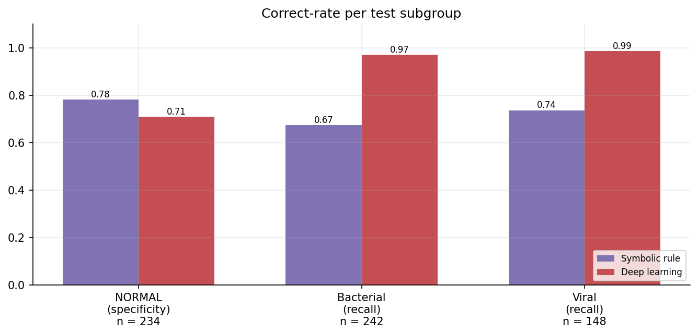

Examples of its most confident mistakes (top: healthy children it was certain had pneumonia; bottom: bacterial pneumonia it missed):

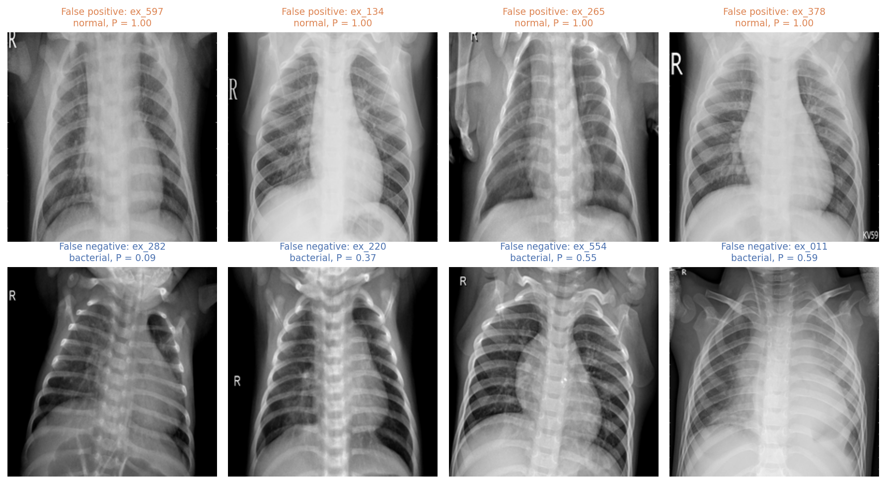

---

## 7. What the results mean, and what they do not

**The network ranks images well but its cut-off did not transfer.** The score distribution makes this visible. On validation (left), healthy images pile up near 0 and sick ones near 1. On the test set (right), many healthy images score high, spilling across the threshold:

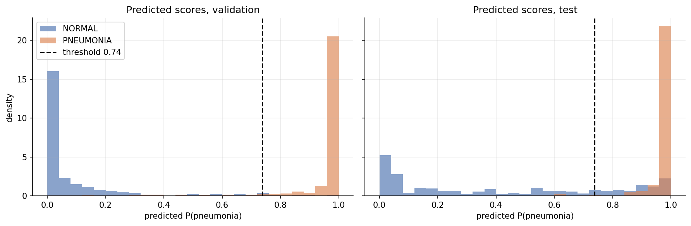

Sweeping the threshold shows the same thing as a trade-off. Dashed lines are validation, solid lines are test. At the chosen threshold (dotted vertical line) validation specificity is about 0.97 but test specificity is 0.71:

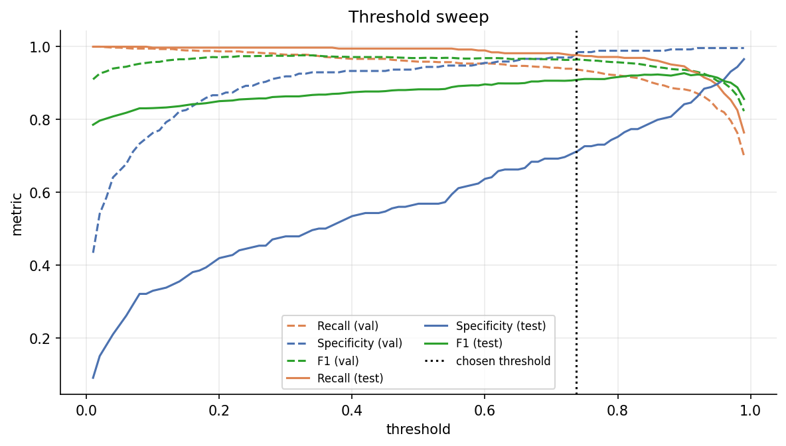

A map of what the network "sees" supports the same story. Test-set normals (blue triangles) include a cluster that sits apart from the validation normals (blue circles), which is what a shift in the data looks like inside the network:

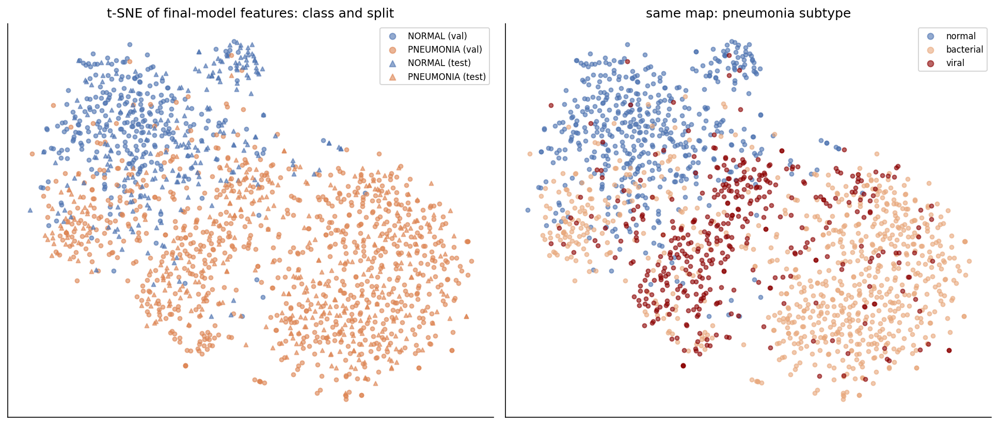

The likely cause is that the validation images are drawn from the same pool as the training images, while the test folder comes from a different part of the dataset. That is a hypothesis supported by these figures, not something proven here.

**The probabilities are over-confident.** 24 healthy test images received a pneumonia probability above 0.95. The test-set Brier score is 0.121 and the expected calibration error 0.144 (0 would be perfect for both). Treat the outputs as scores, not as risks.

**What the network looks at is not clearly the lungs.** In the examples shown, the Grad-CAM heat maps for correctly detected pneumonia are faint and spread across both lungs rather than pointing at a clear opacity, and for false alarms the hot spots fall on the lower middle of the chest (heart and abdomen). This is anecdotal (a handful of images) and not proof of shortcut learning, but it is a reason not to trust the model's reasoning:

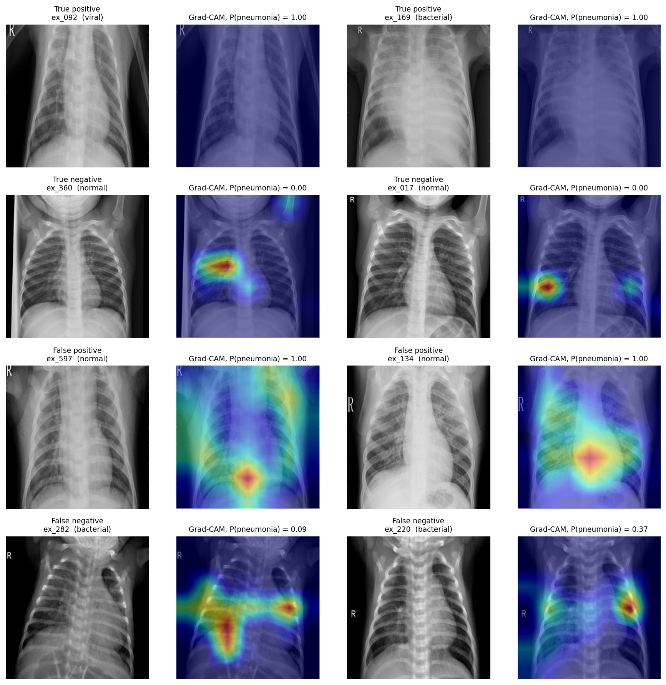

**Cost.** The final model is 9.6 MB, has 2.26 million parameters, and the four tuning and training stages together took about 61 minutes of GPU time. The biggest model tried (ConvNeXtTiny, 112 MB) took about 54 s per training epoch against 9.5 s for the final one and was not more accurate on validation.

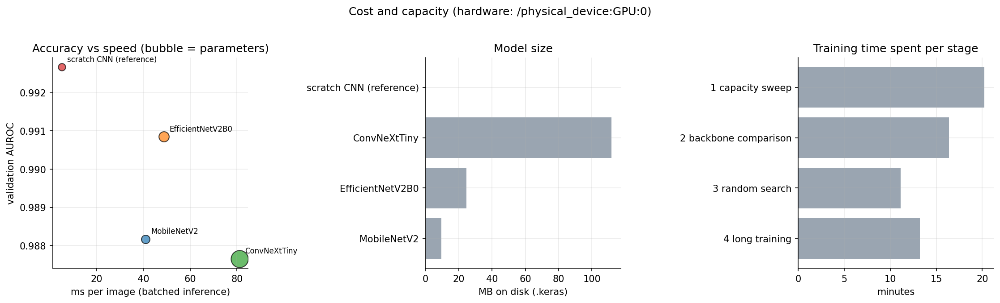

**What cannot be concluded.**

- Nothing here says how the models would do on another hospital, another age group or another scanner. All data are from one hospital and one age group.
- The 40-image human comparison is too small for strong claims.
- A tiny network trained from scratch matched the pretrained one on validation, but it was never run on the test set, so it cannot be ranked against it there.

The full analysis, including the experiments that failed or turned out uninformative, is in [`docs/results-and-limitations.md`](docs/results-and-limitations.md). The reasoning behind each choice is in [`docs/design-decisions.md`](docs/design-decisions.md).

---

## 8. Repository map

```
.
├── README.md                          this file
├── docs/
│   ├── design-decisions.md            every major choice: options, reasons, evidence
│   ├── results-and-limitations.md     full analysis, failures, known issues
│   ├── make_overview_figures.py       redraws the two charts used above
│   └── figures/                       approach_comparison.png, error_breakdown.png
├── data/
│   ├── README.md                      data dictionary and split explanation
│   ├── prepare_data.py                raw download -> image_index.csv, ground_truth.csv, data_checks.txt
│   ├── image_index.csv                one row per image: ID, path, label, patient, split
│   ├── data_checks.txt                split sizes, duplicate and patient-overlap checks
│   └── raw/                           the downloaded dataset (NOT in git)
├── approaches/
│   ├── 1_human_baseline/              labelling tool, the fixed 40 IDs, the 40 images
│   ├── 2_symbolic/                    the rule, feature exploration, tuning, figure
│   └── 3_deep_learning/
│       ├── deep_learning.ipynb        the whole experiment (Keras; run on Colab)
│       ├── prepare_colab_bundle.py    builds the small upload folder for Colab
│       ├── results/                   all tables (CSV/JSON), including test_scores.csv
│       ├── figures/                   23 numbered figures
│       └── models/                    deep_learning_final.keras (9.6 MB)
└── eval/
    ├── eval.py                        scores every approach with the same metrics
    ├── ground_truth.csv               true labels of the 624 test images
    ├── score_human_baseline.py        quick accuracy of the human labels
    └── predictions/                   human_eval.csv, symbolic_eval.csv, deep_learning_eval.csv
```

Example IDs (`ex_001` and so on) are assigned after a seeded shuffle so that the ID order does not reveal the class. Every file in `eval/` refers to images by those IDs.

---

## 9. How to reproduce everything

### Environment

| What | Version used |
|---|---|
| Python | 3.11.9 |
| numpy / pandas / scikit-learn / OpenCV / Pillow / matplotlib | 2.4.6 / 3.1.0 / 1.9.1 / 5.0.0 (`opencv-python-headless`) / 13.0.0 / 3.11.2 |
| Deep learning notebook (Google Colab, GPU runtime) | TensorFlow 2.21.0, Keras 3.13.2 |

There is no requirements file; create a virtual environment and install the packages above. The deep learning notebook installs nothing extra on Colab. Random seed everywhere: **211** (the final training run uses 212).

### Step by step

```bash
# 0. Download the dataset and put it at data/raw/chest_xray/{train,val,test}/{NORMAL,PNEUMONIA}/
#    Kaggle: "Chest X-Ray Images (Pneumonia)" by Paul Mooney

# 1. Build the project split, ground truth and data checks
python data/prepare_data.py

# 2. Human baseline (optional): copy the 40 images, label them in a browser
python approaches/1_human_baseline/prepare_subset.py
open approaches/1_human_baseline/labeller.html      # label, then Export; save the CSV as eval/predictions/human_eval.csv
python eval/score_human_baseline.py

# 3. Symbolic rule: measure features, check thresholds, then run on the test set ONCE
python approaches/2_symbolic/explore_features.py
python approaches/2_symbolic/tune_rule.py
python approaches/2_symbolic/make_symbolic_eval.py --confirm

# 4. Compare everything
python eval/eval.py
```

### Deep learning (Google Colab)

```bash
python approaches/3_deep_learning/prepare_colab_bundle.py     # builds local/colab_upload/pneumonia_project (about 290 MB)
```

1. Upload that folder to Google Drive as `My Drive/pneumonia_project`.
2. Open `approaches/3_deep_learning/deep_learning.ipynb` in Colab, choose **Runtime, Change runtime type, GPU**, and run all cells. Every experiment is cached on Drive, so a disconnect resumes where it stopped.
3. The last cell zips the figures, results and predictions. Copy them into the same paths in this repository.

The test-set cell **refuses to run a second time** (it reloads the saved scores) unless `ALLOW_SECOND_TEST_RUN` is set, so re-running the notebook will not silently change the reported test results. `DL_PROFILE=quick` runs a tiny smoke test.

### Redraw the overview charts

```bash
python docs/make_overview_figures.py
python approaches/2_symbolic/plot_feature_distributions.py
```

### Sanity check that everything is in place

`python eval/eval.py` should print, among other things, for deep learning on the full test set: `TP=381  FP=68  FN=9  TN=166` and `F1 0.908`.

---

## 10. Documentation index

| Document | Read it to learn |
|---|---|
| [`docs/design-decisions.md`](docs/design-decisions.md) | why each major choice was made, what else was possible, and the evidence |
| [`docs/results-and-limitations.md`](docs/results-and-limitations.md) | the complete analysis, what failed, and what the results cannot show |
| [`data/README.md`](data/README.md) | the dataset, the split and the checks |
| [`approaches/1_human_baseline/README.md`](approaches/1_human_baseline/README.md) | how the human baseline was run |
| [`approaches/2_symbolic/README.md`](approaches/2_symbolic/README.md) | how the rule works and how it was tuned |
| [`approaches/3_deep_learning/README.md`](approaches/3_deep_learning/README.md) | the model, experiments, files and how to read each figure |

---

## 11. Status, known issues and credits

**Status.** Approaches 1 to 3 are complete. Approach 4 (LLM) is not started.

**Known issues in the saved outputs** (details and impact in [`docs/results-and-limitations.md`](docs/results-and-limitations.md#9-known-issues-in-the-saved-outputs)):

- Figures 06 and 07 were made before the notebook was changed to weight the validation loss like the training loss. Their loss panels therefore exaggerate the train/validation gap. The notebook now also produces a figure `06b`, which is not in the saved outputs yet. A re-run on Colab is needed to refresh them.
- The "No pretraining" ablation (figure 23) scored exactly 0.5 AUROC, which is a failed experiment (the backbone was frozen at random weights), not evidence about pretraining. The "Frozen backbone" row duplicates the full recipe. Both rows should be ignored until re-run.
- `results/training_minutes_by_stage.csv` has a column called `seconds` whose values are minutes.
- The inference-latency numbers in `results/cost_and_capacity.csv` look inflated by warm-up overhead; rely on model size, parameter count and seconds per epoch.
- The notebook's introduction mentions a helper called `prepare_cache.py`; the script that exists is `prepare_colab_bundle.py`.
- The earlier progress report was written before the one-split refactor, so its train/validation sizes (4,190 / 1,026) differ slightly from the repository's (4,185 / 1,047).

**Credits.** Dataset: Kermany, D. S. et al. (2018), *Identifying medical diagnoses and treatable diseases by image-based deep learning*, Cell 172(5); Kaggle release by Paul Mooney. Pretrained network: MobileNetV2 from `keras.applications` (ImageNet weights). Course: CSC 211H5.
