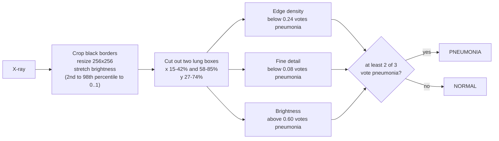
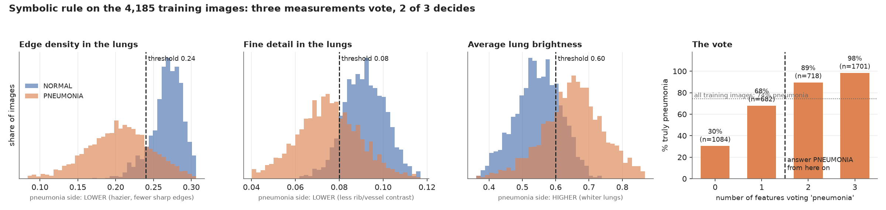

# Approach 2: Symbolic rule

**Question:** how far do three simple, explainable image measurements get, with no model fitted to labels? Context: [root README](../../README.md#52-approach-2-symbolic-rule-no-machine-learning).

"Symbolic" here means a hand-written procedure: a person decides the measurements and cut-offs, and the computer only applies them.

## How the rule works



| Measurement | Computation (in `symbolic.py`) | Plain meaning |
|---|---|---|
| `lung_edges` | share of lung pixels marked by the Canny edge detector (thresholds 40 and 100) | sharp structure; hazy lungs have less |
| `lung_detail` | standard deviation of the image minus a Gaussian-blurred copy (sigma 8) | fine rib and vessel contrast |
| `lung_mean` | average brightness of the lung pixels | pneumonia makes lungs whiter |

Three other candidates were measured and dropped as weaker ([why](../../docs/design-decisions.md#b3-three-features-edge-density-fine-detail-brightness)): share of dark pixels, 10th-percentile brightness and the lung-to-chest brightness ratio.



*Training images only. The three left panels show how each measurement separates the classes (dashed line = cut-off); the right panel shows that the more measurements vote "pneumonia", the more likely the image truly has it.*

## Files

| File | Purpose |
|---|---|
| `symbolic.py` | The rule: `extract_features`, `votes_for` (which measurement voted how, i.e. the explanation), `predict`. Running it with no argument classifies the sample image `sample/ex_485.jpeg`. |
| `explore_features.py` | Measures all six candidate features on the **train** and **val** images and prints how well each separates the classes. Caches to `train_features.csv`. Never reads the test set. |
| `tune_rule.py` | Compares two ways of setting thresholds and 1, 2 or 3 required votes. Train sets the thresholds, val checks them. Never reads the test set. |
| `make_symbolic_eval.py` | Runs the frozen rule **once** on the test set and writes `eval/predictions/symbolic_eval.csv`. Refuses to run without `--confirm`. |
| `plot_feature_distributions.py` | Draws the figure above from `train_features.csv` and the thresholds in `symbolic.py`. |
| `train_features.csv` | Cached feature values for the 5,232 train and val images. |
| `sample/ex_485.jpeg` | The one example image used for the demo run. |

## How the thresholds and the vote were chosen (training data only)

- **Cut-offs:** halfway between the NORMAL median and the PNEUMONIA median of each measurement on the training images: 0.24, 0.08, 0.60. Choosing instead the cut that maximises balanced accuracy gave 0.24, 0.08, 0.61, so the simpler rule won.
- **Votes needed:**

| Votes needed | Balanced accuracy (train) | Balanced accuracy (val) | Recall (train) | Specificity (train) |
|---|---|---|---|---|
| 1 of 3 | 0.797 | 0.783 | 0.894 | 0.700 |
| **2 of 3** | **0.824** | **0.798** | 0.745 | 0.903 |
| 3 of 3 | 0.756 | 0.720 | 0.538 | 0.973 |

## Result on the test set (run once, after the rule was frozen)

| Metric | Value | 95% CI |
|---|---|---|
| F1 | 0.763 | 0.725 to 0.798 |
| Recall | 0.697 | 0.649 to 0.743 |
| Specificity | 0.782 | 0.731 to 0.834 |
| Precision | 0.842 | |
| Balanced accuracy | 0.740 | 0.702 to 0.775 |

Confusion counts: TP 272, FP 51, FN 118, TN 183. On the 40-image human subset: F1 0.711, recall 0.571, specificity 0.917.

**Failure pattern.** The rule misses 30% of pneumonia, mostly cases whose lungs look as dark and finely textured as healthy ones. A whole-lung average cannot see small, patchy pneumonia. Its false alarms are healthy children with bright, soft-looking lungs. Recall is 67.4% on bacterial and 73.6% on viral pneumonia.

## Reproduce

Needs Python 3.11, OpenCV (`opencv-python-headless` 5.0.0), numpy 2.4.6, scikit-learn and pandas. Run from the repository root:

```bash
python approaches/2_symbolic/symbolic.py                     # demo on the sample image
python approaches/2_symbolic/explore_features.py             # add --rebuild to recompute the cache
python approaches/2_symbolic/tune_rule.py
python approaches/2_symbolic/make_symbolic_eval.py --confirm # the one test run
python approaches/2_symbolic/plot_feature_distributions.py
```

Inference is deterministic, and the rule must not be changed after seeing test results.
