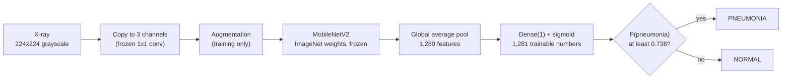

# Approach 3: Deep learning

**Question:** how well does a standard pretrained image network do on this task, and what does it cost? Context: [root README](../../README.md#53-approach-3-deep-learning). Reasoning for each choice: [design decisions, section C](../../docs/design-decisions.md#c-deep-learning). Full analysis: [results and limitations](../../docs/results-and-limitations.md).

## What the final model is



| Setting | Value |
|---|---|
| Backbone | MobileNetV2, ImageNet weights, whole backbone frozen (`unfreeze = 0`) |
| Trainable parameters | 1,281 (of 2.26 million in total) |
| Learning rate / weight decay / dropout | 9.1e-5 / 9.2e-4 / 0.0 |
| Augmentation | mild (rotation, zoom, shift, brightness, contrast), no horizontal flip |
| Class weights | on (normal images count about 2.9 times as much) |
| Training | 3 head-only epochs, then 40 more; AdamW, cosine learning-rate decay, no early stopping |
| Final model | seed 212, best validation AUROC at epoch 35 (0.9923) |
| Threshold | 0.738, Youden's J on validation |
| Saved file | `models/deep_learning_final.keras` (9.6 MB) |
| Software | TensorFlow 2.21.0, Keras 3.13.2, Colab GPU, seed 211 (final run 212) |

## Result (test set, 624 images, scored once)

F1 **0.908** (0.884 to 0.930), recall **0.977**, specificity 0.709, precision 0.849, balanced accuracy 0.843, MCC 0.740, AUROC 0.964 (0.949 to 0.977). Confusion counts: TP 381, FN 9, FP 68, TN 166. On the 40-image human subset: 39 of 40 correct.

## Files

| Path | What it is |
|---|---|
| `deep_learning.ipynb` | The entire experiment as a notebook: sanity checks, model, four tuning stages, threshold, the single test run, all figures. Runs on Colab; each experiment is cached so a disconnect resumes. Profiles: `quick` (tiny smoke test), `standard` (default), `long`. |
| `prepare_colab_bundle.py` | Builds `local/colab_upload/pneumonia_project/` (about 290 MB): the index and evaluation files plus every image pre-resized to 224×224 (`dl_work/images_224.npy`), so the 1.2 GB raw dataset need not be uploaded. |
| `results/` | All tables, listed below. |
| `figures/` | 23 numbered PNG figures, listed below. |
| `models/deep_learning_final.keras` | The final model. |
| `../../eval/predictions/deep_learning_eval.csv` | `Example ID, Deep Learning Prediction, Deep Learning Probability` for all 624 test images; read by `eval/eval.py`. |

### `results/`

| File | Content |
|---|---|
| `test_metrics.csv` | Every metric and 95% interval for always-positive, the symbolic rule and the network (full test set) |
| `test_scores.csv` | Per-image test probability, label and subtype; the figures are built from it |
| `human_subset_metrics.csv` | The same metrics on the 40-image human subset |
| `subgroup_performance.csv` | Correct rate for normal / bacterial / viral, rule and network |
| `stage1_capacity.csv`, `stage2_backbones.csv`, `stage3_random_search.csv` | The three tuning stages (validation AUROC) |
| `long_training_runs.csv` | The two long-run seeds |
| `ablation.csv`, `learning_curve.csv` | Experiments that explain why it works (validation only) |
| `cost_and_capacity.csv`, `training_minutes_by_stage.csv` | Parameters, size, timings (note: the `seconds` column holds minutes; latency columns unreliable) |
| `best_config.json`, `run_info.json` | The final configuration, threshold, seeds and software versions |

### `figures/` (what each one shows)

| Group | Figures |
|---|---|
| The data | 01 class balance per split; 02 sample images and augmentation |
| Tuning | 03 capacity vs overfitting; 04 backbone comparison; 05 hyperparameter search |
| Training | 06 long-training curves; 07 generalization gap; 08 what each extra epoch buys |
| Performance | 09 confusion matrices; 10 ROC curve; 11 precision-recall curve; 12 model comparison; 13 confidence intervals |
| Behaviour | 14 score distributions (validation vs test); 15 threshold sweep; 16 calibration; 20 t-SNE of learned features |
| Course considerations | 17 Grad-CAM (explainability); 18 error gallery; 19 subgroup performance (fairness); 21 cost and capacity |
| Why it works | 22 learning curve; 23 ablation |

Each figure has a "what it represents / how to read it" explanation in the notebook beside the code that makes it. Figures 06 and 07 pre-date a notebook fix (see below).

## Rules the notebook follows

- Train on `train`, choose on `val`, touch `test` exactly once. The test cell reloads `results/test_scores.csv` instead of running again, unless `ALLOW_SECOND_TEST_RUN` is set.
- The model sees only pixels. File names (which contain "bacteria" or "virus") are never an input.
- Python and Keras only (course requirement).

## Reproduce

```bash
python approaches/3_deep_learning/prepare_colab_bundle.py
```

1. Upload `local/colab_upload/pneumonia_project` to Google Drive as `My Drive/pneumonia_project`.
2. Open `deep_learning.ipynb` in Colab with a GPU runtime and run all cells (the four tuning and training stages took about 61 minutes of GPU time).
3. Copy the zipped figures, results and predictions it produces into this folder and `eval/predictions/`.

## Known issues in the saved outputs

Figures 06 and 07 loss panels pre-date the fix that weights validation loss like training loss (the `06b` figure is not saved yet); the "No pretraining" ablation failed (AUROC exactly 0.5) and the "Frozen backbone" row duplicates the final recipe; the notebook intro names a non-existent `prepare_cache.py` (the script is `prepare_colab_bundle.py`). Details and fixes: [results and limitations, section 9](../../docs/results-and-limitations.md#9-known-issues-in-the-saved-outputs).
