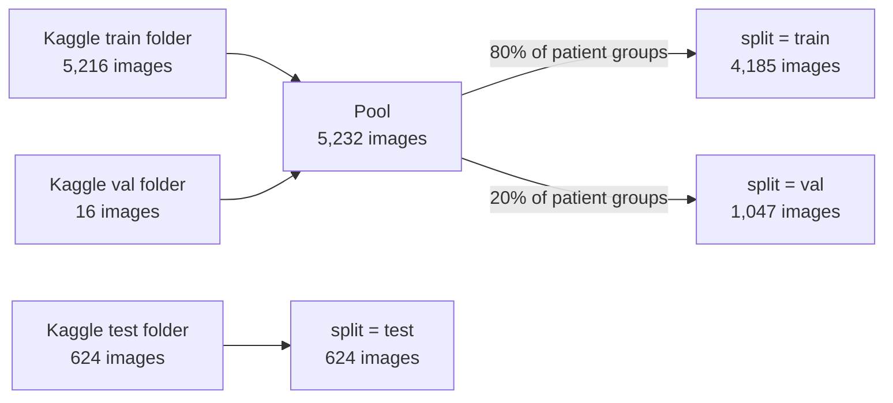

# Data

This folder turns the raw Kaggle download into the **one split and one set of IDs** that every approach in the project uses. Start with the [root README](../README.md) if you have not read it.

## What is in this folder

| Path | What it is | In git? |
|---|---|---|
| `prepare_data.py` | The only script that reads the raw download. Writes the three files below. | yes |
| `image_index.csv` | One row per image (5,856 rows): ID, path, label, patient, original folder, project split. | yes |
| `data_checks.txt` | Split sizes, class balance, duplicate check and patient-overlap check, regenerated every time `prepare_data.py` runs. | yes |
| `raw/chest_xray/` | The downloaded dataset (about 1.2 GB). | **no** (git-ignored) |

`prepare_data.py` also writes `eval/ground_truth.csv` (the true label of each of the 624 test images).

## Getting the raw data

1. Download *Chest X-Ray Images (Pneumonia)* by Paul Mooney from Kaggle (it is derived from Kermany et al., 2018, Cell 172(5)).
2. Unzip it so that this layout exists:

```
data/raw/chest_xray/
├── train/  NORMAL/  PNEUMONIA/        5,216 images
├── val/    NORMAL/  PNEUMONIA/           16 images
└── test/   NORMAL/  PNEUMONIA/          624 images
```

3. From the repository root run:

```bash
python data/prepare_data.py        # needs scikit-learn
```

It is deterministic (seed 211): running it again reproduces `image_index.csv`, `ground_truth.csv` and `data_checks.txt` exactly.

The images are JPEGs of very different sizes: widths 384 to 2,916 pixels (median 1,281) and heights 127 to 2,713 pixels (median 888), measured on this download. Every approach therefore rescales them (the rule to 256×256, the neural network to 224×224).

## The split



| `split` | Images | Normal | Pneumonia | % pneumonia | Pneumonia patients | Purpose |
|---|---|---|---|---|---|---|
| `train` | 4,185 | 1,079 | 3,106 | 74.2% | 1,313 | learn; design the rule |
| `val` | 1,047 | 270 | 777 | 74.2% | 329 | compare settings; choose the threshold |
| `test` | 624 | 234 | 390 (242 bacterial, 148 viral) | 62.5% | 202 | final score, once |

How it is built:

- **`test`** is Kaggle's `test/` folder exactly as downloaded.
- **`train` and `val`** are an 80/20 split of Kaggle's `train/` and `val/` folders pooled together, using scikit-learn's `StratifiedGroupKFold` (5 folds, fold 0, `shuffle=True`, seed 211). *Stratified* keeps the pneumonia share equal in both parts (74.2% each); *grouped* keeps all images of one patient on the same side.
- The Kaggle `val/` folder is merged into the pool because 16 images are too few to tune on.

## `image_index.csv`

| Column | Meaning | Example |
|---|---|---|
| `Example ID` | The ID used everywhere else. The prefix shows the Kaggle folder (`train_`, `val_`, `ex_` for test). The `split` column, not the prefix, decides the project split. | `train_0002` |
| `path` | Image path relative to the repository root. | `data/raw/chest_xray/train/PNEUMONIA/person969_bacteria_2894.jpeg` |
| `label` | `1` = PNEUMONIA (Positive), `0` = NORMAL (Negative), taken from the folder name. | `1` |
| `patient_id` | Pneumonia: `P<N>` from the file name `person<N>_...` (bacterial and viral files with the same N are one patient). Normal: a unique value per image, `N_<Example ID>`. | `P969` |
| `kaggle_split` | The folder the image came from: `train`, `val` or `test`. | `train` |
| `split` | The project split: `train`, `val` or `test`. **This is the column every approach reads.** | `train` |

The first rows:

```text
Example ID,path,label,patient_id,kaggle_split,split
train_0001,data/raw/chest_xray/train/NORMAL/NORMAL2-IM-0851-0001-0002.jpeg,0,N_train_0001,train,train
train_0002,data/raw/chest_xray/train/PNEUMONIA/person969_bacteria_2894.jpeg,1,P969,train,train
```

## Why the IDs look the way they do

IDs are assigned after a seeded shuffle (one `random.Random(211)`, shuffling the train folder, then the val folder, then the test folder), so ID order carries no class information (without the shuffle, all NORMAL images would come first). **The shuffle order must never change**: every ID in `eval/` depends on it. File names are never given to a model or a person because pneumonia file names contain "bacteria" or "virus", which would give the answer away. The pneumonia subtype is read from file names only after prediction, for the subgroup analysis.

## What `data_checks.txt` verifies

| Check | Result |
|---|---|
| Exact duplicate images between the Kaggle folders (by SHA-256) | 0 between train and test, train and val, and val and test |
| Patients shared between project `train` and `val` | 0 (the script stops with an error otherwise) |
| Pneumonia patient numbers shared between Kaggle `train` and `test` folders | **170** |
| Pneumonia patient numbers shared between `train` and `val`, and `val` and `test` folders | 0 |

## Known limitations of the data

- **Possible overlap between Kaggle train and test.** 170 pneumonia patient numbers appear in both folders. A shared number may be the same child or two different children; the file names cannot tell. The test set is kept as is (it is the published benchmark) and the overlap is reported, not fixed. If these are the same children, test performance on pneumonia is somewhat optimistic.
- **Normal images have no patient ID.** The `IM-xxxx` number in their file names is a coincidence, so each normal image is its own group, and one child's normal X-rays could land on both sides of the train/validation split. Validation is therefore slightly optimistic.
- **The test set differs from train and validation.** Pneumonia is 62.5% of it versus about 74%, and later results show the network behaves differently on its normal images ([analysis](../docs/results-and-limitations.md#4-why-validation-was-too-optimistic)).
- **One hospital, one age group** (1 to 5 years). Sex, age and scanner are not recorded.
- **The dataset card and the download disagree slightly:** the card lists 5,863 images; this download has 5,856.
