# Results and limitations

The full analysis behind the [root README](../README.md). It covers what the numbers are, what they mean, which experiments were informative, which ones failed, and what the results cannot show. The reasoning behind each design choice is in [design-decisions.md](design-decisions.md).

**Conventions.** Positive = PNEUMONIA, Negative = NORMAL. "Test" numbers were measured once on the 624-image test set after every choice was frozen. "Validation" numbers (val) come from 1,047 images held out of the training pool and were used to make choices. Confidence intervals (CI) are 95% intervals from a bootstrap that resamples patients.

## Contents

1. [Headline](#1-headline)
2. [Deep learning on the test set](#2-deep-learning-on-the-test-set)
3. [The symbolic rule and the human baseline](#3-the-symbolic-rule-and-the-human-baseline)
4. [Why validation was too optimistic](#4-why-validation-was-too-optimistic)
5. [Calibration: how much to trust the probabilities](#5-calibration-how-much-to-trust-the-probabilities)
6. [Subgroups (fairness)](#6-subgroups-fairness)
7. [Explainability](#7-explainability)
8. [What each experiment showed](#8-what-each-experiment-showed)
9. [Known issues in the saved outputs](#9-known-issues-in-the-saved-outputs)
10. [Limitations](#10-limitations)
11. [What I would do next](#11-what-i-would-do-next)

---

## 1. Headline

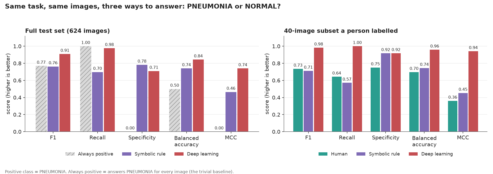

| Claim | Supported by | Strength |
|---|---|---|
| The neural network finds far more pneumonia than the hand-written rule (recall 0.977 versus 0.697) | non-overlapping CIs (0.960 to 0.991 versus 0.649 to 0.743 for the rule) | strong |
| The network has the higher F1 (0.908 versus 0.763) | non-overlapping CIs (0.884 to 0.930 versus 0.725 to 0.798) | strong |
| The network is worse at clearing healthy children than the rule (0.709 versus 0.782) | overlapping CIs (0.650 to 0.769 versus 0.731 to 0.834) | **not established** |
| The network beats the human baseline | 39/40 versus 27/40 on the same 40 images | weak: n = 40, only 12 healthy images |
| Pretraining improves accuracy | scratch CNN matches it on validation with at least half the data | **not supported**; pretraining helps with little data only |
| Results hold at other hospitals or ages | no data | **cannot be concluded** |

---

## 2. Deep learning on the test set

The final model: MobileNetV2 (ImageNet weights, whole backbone frozen) plus a one-unit sigmoid head with 1,281 trainable numbers. Threshold 0.738, chosen on validation.

| Metric | Value | 95% CI |
|---|---|---|
| F1 | 0.908 | 0.884 to 0.930 |
| Recall | 0.977 | 0.960 to 0.991 |
| Specificity | 0.709 | 0.650 to 0.769 |
| Precision | 0.849 | 0.809 to 0.884 |
| Accuracy | 0.877 | 0.849 to 0.903 |
| Balanced accuracy | 0.843 | 0.810 to 0.873 |
| MCC | 0.740 | 0.686 to 0.792 |
| AUROC | 0.964 | 0.949 to 0.977 |
| AUPRC | 0.977 | 0.964 to 0.987 |
| Brier score | 0.121 | |
| Expected calibration error | 0.144 | |

Source: [`approaches/3_deep_learning/results/test_metrics.csv`](../approaches/3_deep_learning/results/test_metrics.csv). Confusion counts: TP 381, FN 9, FP 68, TN 166.

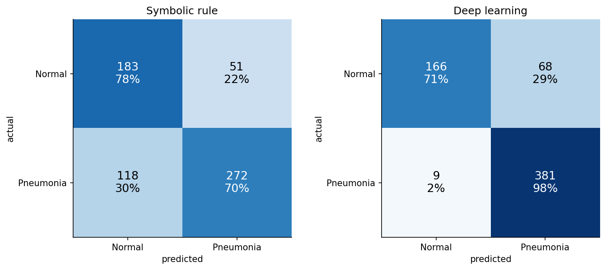

**Reading the confusion matrices.** The lower-left cell is the costly mistake in screening (pneumonia called normal): 9 of 390 (2%) for the network, 118 of 390 (30%) for the rule. The upper-right cell is the false alarm: 68 of 234 (29%) for the network, 51 of 234 (22%) for the rule.

**Reading the ROC curve.** AUROC of 0.964 means that if you pick one sick and one healthy image at random, the network scores the sick one higher 96.4% of the time. The curve (below) lies far above the single points of the rule and the human, so at *any* false-alarm rate the network would catch more pneumonia than they do.

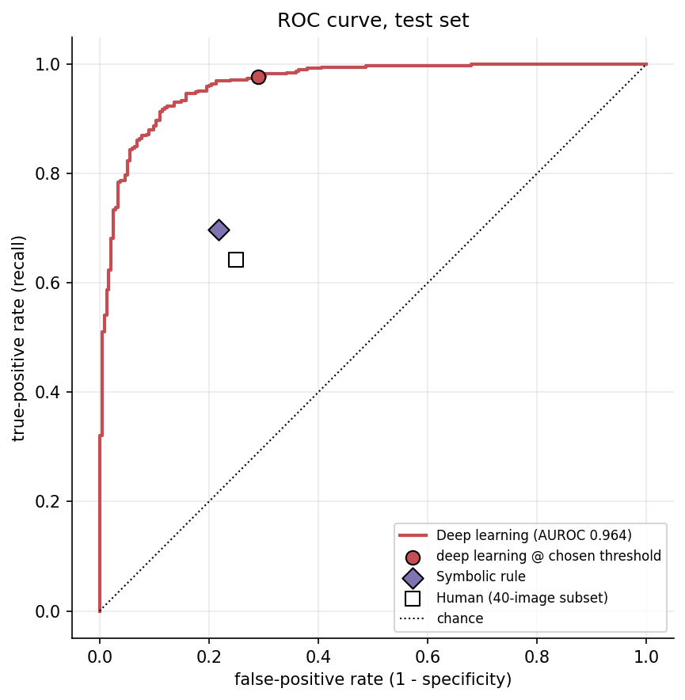

**Reading the intervals.** The forest plot shows every metric with its interval for each approach, including the trivial "always pneumonia" baseline.

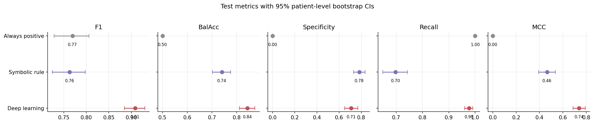

---

## 3. The symbolic rule and the human baseline

### Symbolic rule (full test set)

| Metric | Value | 95% CI |
|---|---|---|
| F1 | 0.763 | 0.725 to 0.798 |
| Recall | 0.697 | 0.649 to 0.743 |
| Specificity | 0.782 | 0.731 to 0.834 |
| Accuracy | 0.729 | 0.691 to 0.765 |
| Balanced accuracy | 0.740 | 0.702 to 0.775 |
| MCC | 0.465 | 0.394 to 0.536 |

Confusion counts: TP 272, FN 118, FP 51, TN 183. It misses 118 pneumonia cases; from the rule's own feature values, 99 of them have lung brightness at or below the 0.60 threshold and 41 get no pneumonia vote at all. Their median brightness (0.562) is close to that of correctly cleared normals (0.530) and far from that of caught pneumonia (0.668). Those figures come from the author's error analysis in the written report in `docs/` (computed with `symbolic.py` on the test images). The training-data picture (the rule's three features, and the vote) is in the next figure:

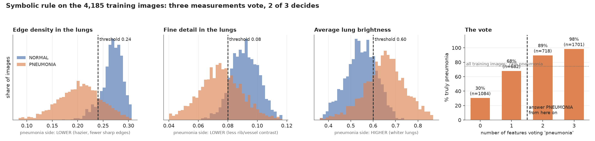

On the training images the rule is more accurate than on the test set (balanced accuracy 0.824 on train, 0.798 on validation, 0.740 on test): it is an unfitted rule, but the thresholds were still set by looking at training data, and the test images differ.

### Human baseline (40 test images)

| | Human | Symbolic | Deep learning |
|---|---|---|---|
| Correct | 27 / 40 | 27 / 40 | 39 / 40 |
| Recall (28 sick images) | 0.643 (18 caught, 10 missed) | 0.571 (16 / 12) | 1.000 (28 / 0) |
| Specificity (12 healthy images) | 0.750 (9 cleared, 3 false alarms) | 0.917 (11 / 1) | 0.917 (11 / 1) |
| F1 | 0.735 | 0.711 | 0.982 |

The human and the rule disagree on 20 of the 40 images and each is right on 10 of them. This subset therefore **cannot say which is better**. A 95% interval for 39/40 is roughly 0.84 to 1.00 and for 27/40 roughly 0.50 to 0.82, which barely separates them; and the subset is easier than the full test set for the network (0.975 here against 0.877 on all 624).

---

## 4. Why validation was too optimistic

This is the most important finding about the deep learning model, because it explains the weak specificity.

| Quantity | Validation | Test |
|---|---|---|
| AUROC | about 0.992 (best seed) | 0.964 (CI 0.949 to 0.977) |
| Specificity at threshold 0.738 | about 0.97 (read from figure 15) | 0.709 |
| Specificity at threshold 0.5 | about 0.93 (long-run curves, figure 06) | 0.568 |
| Share of pneumonia | 74.2% | 62.5% |

The validation AUROC lies outside the test CI, so this is not just sampling noise.

**Evidence 1, score distributions.** On validation, healthy images score near 0. On the test set many healthy images score high and cross the threshold.

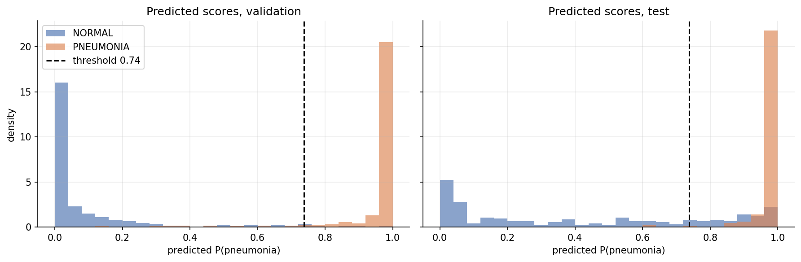

**Evidence 2, the threshold sweep.** Dashed lines (validation) and solid lines (test) of the same colour agree for recall but diverge sharply for specificity.

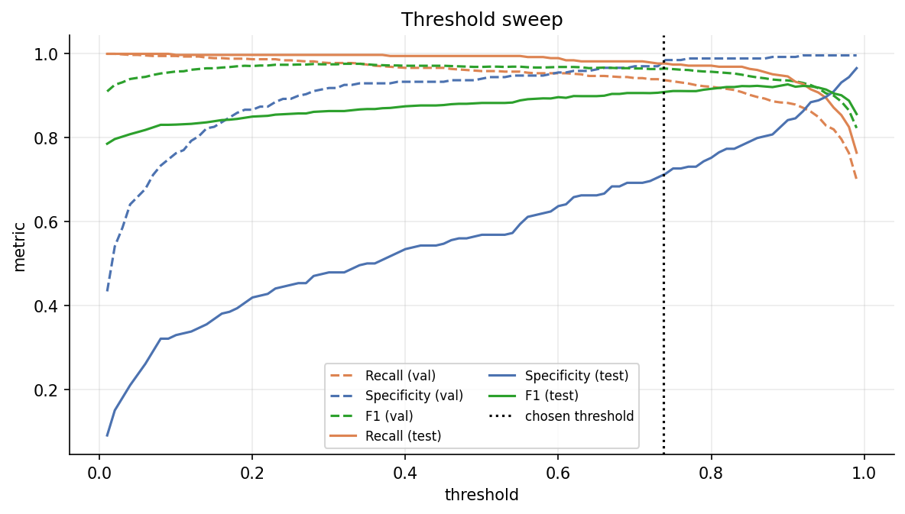

**Evidence 3, feature space.** In the network's internal features (t-SNE, a 2-D map of how the network groups images), the test normals (triangles) include a cluster of their own, away from the validation normals (circles). Viral pneumonia (dark red, right panel) sits between normal and bacterial, which fits the subgroup results below.

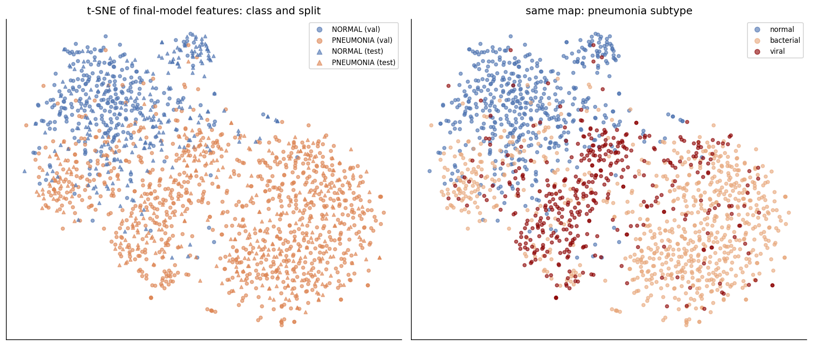

**What I conclude and what I do not.** The test normals are different from the training and validation normals, and the network is uncertain on them, so a threshold chosen on validation is too lenient on the test set. The most likely cause is that validation was drawn from the same pool as the training images while the Kaggle test folder is a separate part of the dataset; this is a hypothesis consistent with the three figures, not something I proved (I have no scanner, date or hospital-site information to check it).

**This is not only a threshold problem.** A diagnostic that picks the best cut-off *using the test labels* (not a valid result, shown only as a diagnosis) reaches recall about 0.92 and specificity about 0.88, F1 about 0.92. That is a modest gain over the reported F1 of 0.908 with a clearly different balance of errors. The ranking itself (AUROC) also dropped, so part of the problem is the images, not just the cut-off.

In short: a prevalence-independent threshold rule (Youden's J) removes one cause of the shift (the different share of pneumonia in test) but cannot remove the other (the test images themselves look different).

---

## 5. Calibration: how much to trust the probabilities

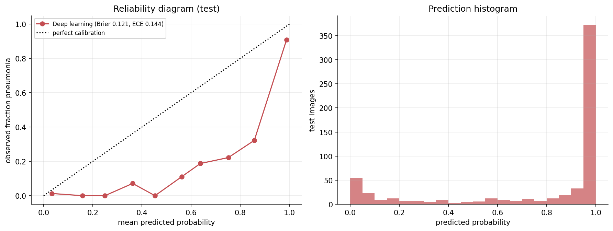

*Left: among test images given probability around p, what fraction truly had pneumonia? A perfect model follows the dotted diagonal. Right: how many test images fall in each probability range.*

- The red curve is far below the diagonal: images the network gave about 0.75 were pneumonia only about 22% of the time, and images given about 0.86 only about 32%. Even at about 0.99 the observed rate was about 0.91.
- The right panel shows most images get a probability near 0 or 1, even when the network is wrong: 24 healthy images received a probability above 0.95 and 8 above 0.99.
- Brier score 0.121 and expected calibration error 0.144 quantify this (0 would be perfect for both).

**Consequence.** Do not read the output as "the chance this child has pneumonia". It is a ranking score. Class weighting in training also deliberately shifts probabilities upwards for the rarer class, which contributes.

---

## 6. Subgroups (fairness)

Pneumonia subtype is readable only from file names, so it is used only here, after prediction. The table shows the share of each group answered correctly (recall for the two pneumonia groups, specificity for normals).

| Group | n | Deep learning | Symbolic rule |
|---|---|---|---|
| Bacterial pneumonia | 242 | 97.1% (7 missed) | 67.4% |
| Viral pneumonia | 148 | 98.6% (2 missed) | 73.6% |
| Normal | 234 | 70.9% (68 false alarms) | 78.2% |

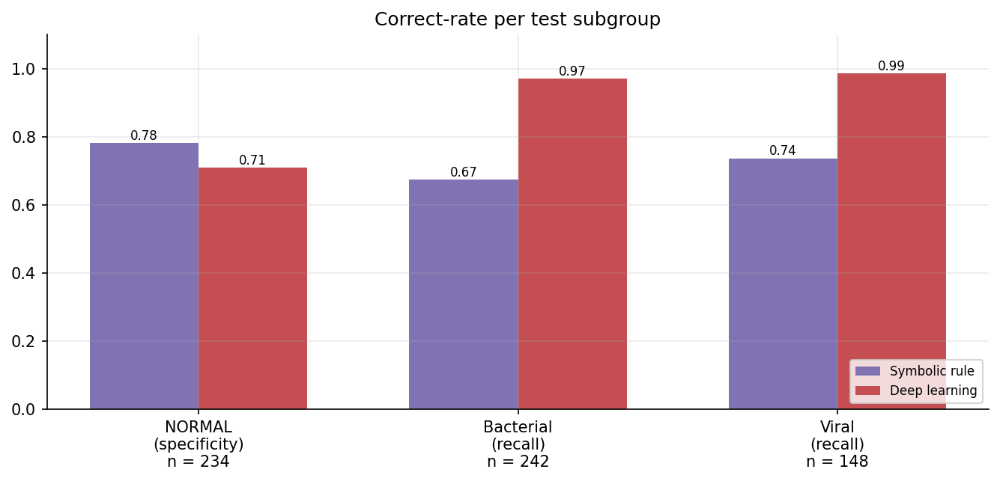

**Findings.** The network treats the two pneumonia types almost equally (a 1.5 point gap on 242 and 148 images is within noise), while the rule is clearly weaker on bacterial pneumonia. The group the network serves worst is **healthy children**, who receive false alarms. **Not checkable:** age, sex and scanner are not in the data, and every image comes from one hospital and one age group (1 to 5 years), so no conclusion about other groups is possible.

---

## 7. Explainability

The rule explains itself: `votes_for` in `symbolic.py` returns which of the three measurements voted for pneumonia on any image. A neural network cannot do this directly, so Grad-CAM is used: a heat map of the image regions that pushed the network's score towards "pneumonia". Rows: true positive, true negative, false positive, false negative (two examples each).

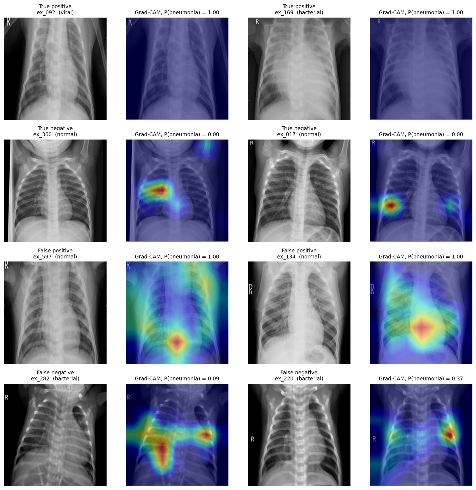

What these eight examples show:

- Correctly detected pneumonia (row 1): faint, spread across both lungs. There is no sharp hot spot on a visible opacity.
- Correctly cleared normals (row 2): a hot spot at the lung periphery.
- False alarms (row 3): strong hot spots in the lower middle of the chest (heart and upper abdomen), not on lung tissue.
- Missed pneumonia (row 4): heat on lateral edges, and one image (`ex_282`) scored only 0.09.

**Interpretation.** With a frozen backbone the network may be relying on global texture and brightness cues rather than a local lesion. Eight images are an anecdote, not a proof, and Grad-CAM shows *where* the model looked, not *why*. But it is a reason not to trust the model to be "right for the right reason", and it matters most because the false alarms (the weak side) are the ones that do not point at the lungs.

The most confident errors, for qualitative review:

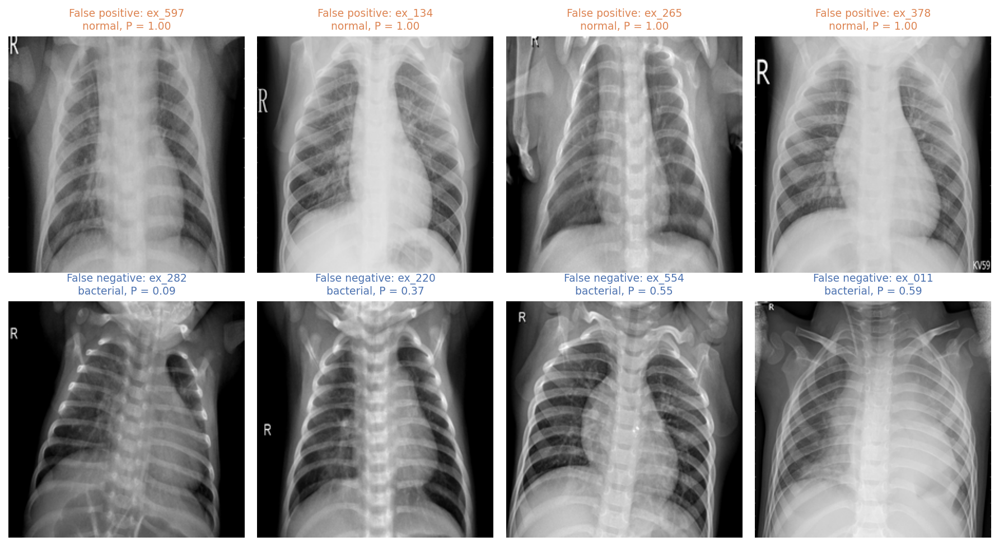

Top row: healthy children scored P = 1.00; one has a text marker in a corner (`ex_378`). Bottom row: bacterial pneumonia, among the missed ones; several appear to show raised arms, tubes or unusual positioning, but I did not test whether any such feature explains the misses.

---

## 8. What each experiment showed

All of these use validation AUROC only. Differences under about 0.01 are inside the noise (the best scores of the two long-run seeds differ by 0.002, and the selection rule treats anything under 0.01 as a tie).

### 8.1 Capacity: how much of the backbone to retrain (stage 1, EfficientNetV2B0)

| Unfrozen | Trainable numbers | Val AUROC | Best epoch | Minutes |
|---|---|---|---|---|
| 0% (head only) | 1,281 | 0.9908 | 14 | 3.3 |
| 25% | 2,726,337 | 0.9975 | 11 | 3.6 |
| 50% | 4,567,049 | 0.9983 | 11 | 4.2 |
| 100% | 5,799,377 | 0.9992 | 7 | 6.5 |

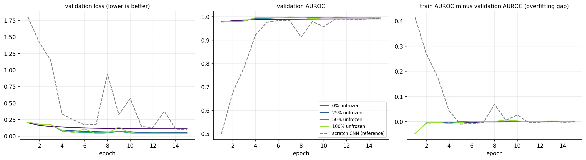

*Left: validation loss. Middle: validation AUROC. Right: train AUROC minus validation AUROC (the overfitting gap). The solid lines nearly coincide: retraining more of the network never opened a visible gap. The dashed grey scratch CNN is much noisier early on and needs many epochs to settle.*

More capacity helped steadily but by only 0.008 in total, so the head-only model won the tie rule. This is the capacity setting of the design (how much of the pretrained network is retrained), and the result is that this task, with these images, does not need much capacity on the validation data. Whether that holds on the shifted test set is unknown.

### 8.2 Which backbone (stage 2, head only)

| Backbone | Parameters | Size on disk | Seconds per epoch | Val AUROC |
|---|---|---|---|---|
| MobileNetV2 | 2.26 M | 9.6 MB | 9.5 | 0.9882 |
| EfficientNetV2B0 | 5.92 M | 24.7 MB | 12.6 | 0.9908 |
| ConvNeXtTiny | 27.82 M | 111.8 MB | 54.3 | 0.9877 |

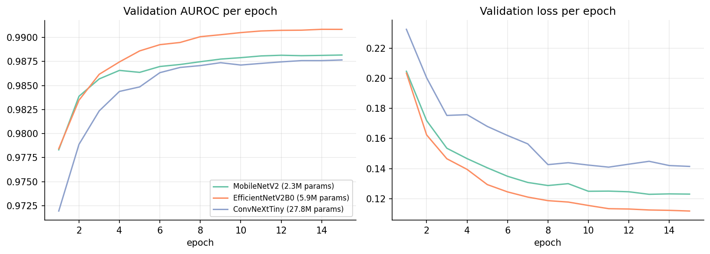

The three are within 0.003 of each other, a tie. ConvNeXtTiny has 12 times as many parameters as MobileNetV2, is almost six times slower to train and about 12 times bigger on disk, yet is no more accurate, so the smallest model won.

### 8.3 Small settings (stage 3, random search)

Five random trials plus the defaults, every run within 0.984 to 0.988:

| Trial | Learning rate | Weight decay | Dropout | Augmentation | Val AUROC |
|---|---|---|---|---|---|
| 1 (chosen) | 9.1e-5 | 9.2e-4 | 0.0 | mild | 0.9880 |
| 3 | 2.3e-4 | 5.1e-4 | 0.2 | mild | 0.9876 |
| 4 | 1.6e-4 | 2.4e-4 | 0.2 | mild | 0.9876 |
| defaults | 1.0e-4 | 1.0e-4 | 0.3 | mild | 0.9873 |
| 5 | 1.9e-5 | 4.1e-4 | 0.2 | strong | 0.9852 |
| 2 | 3.2e-4 | 3.4e-4 | 0.4 | strong | 0.9843 |

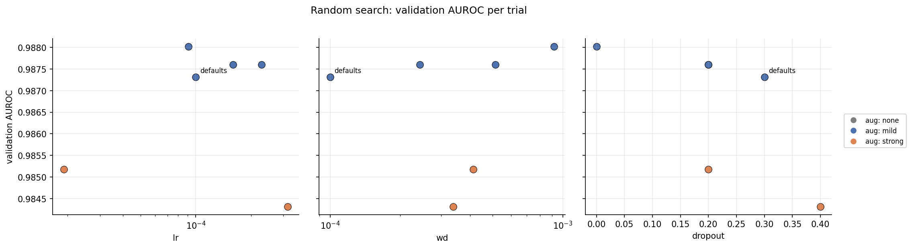

The model is not sensitive to these settings; the only visible pattern is that "strong" augmentation scored lowest. The chosen trial beat the defaults by 0.0007, which is noise, so the tuning bought nothing measurable.

### 8.4 Longer training (stage 4)

Two seeds, 43 epochs each. Best validation AUROC 0.9903 (seed 211, epoch 39) and 0.9923 (seed 212, epoch 35); seed 212 became the final model.

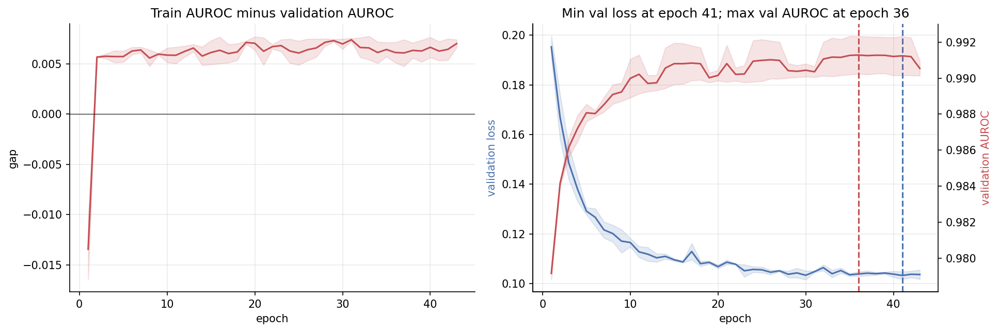

*Left: train AUROC minus validation AUROC settles at about 0.007, a small gap (AUROC is unaffected by the loss-weighting issue in section 9). Right: validation loss (blue) bottoms out at epoch 41 and validation AUROC (red) peaks at epoch 36 (mean of the two seeds); there is no sign of the AUROC collapsing, and the two markers are close together.*

Training the head only for 40 more epochs mostly refines the probabilities: AUROC gains after about epoch 12 are small (about 0.001), which is what you would expect when only 1,281 numbers can change.

### 8.5 Data efficiency: pretrained against scratch

| Training images | Pretrained (final recipe) | Scratch CNN (98 K parameters) |
|---|---|---|
| 398 (10%) | 0.9686 | 0.7373 |
| 1,013 (25%) | 0.9818 | 0.9459 |
| 2,085 (50%) | 0.9868 | 0.9872 |
| 4,185 (100%) | 0.9885 | 0.9905 |

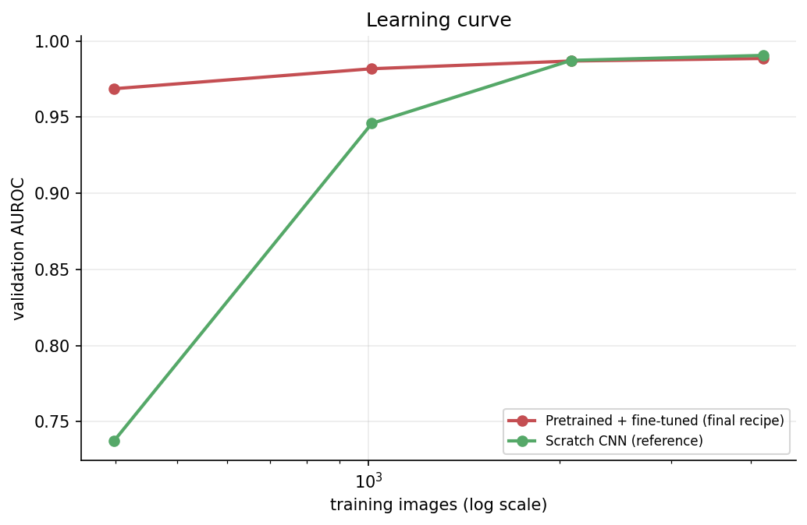

The advantage of pretraining is large with little data and vanishes at about 2,000 images. Neither curve has fully flattened at 100%, so more data might still help both. The scratch CNN being competitive on validation is a surprise, and was never checked on the test set.

### 8.6 Ablations (one change at a time)

| Variant | Val AUROC | Trustworthy? |
|---|---|---|
| Full recipe | 0.9885 | yes |
| No augmentation | 0.9932 | yes; augmentation did not help on validation |
| No class weighting | 0.9886 | yes; no effect on ranking |
| + horizontal flip | 0.9882 | yes; no effect |
| Frozen backbone (head only) | 0.9885 | **no: identical to the full recipe, which is already head-only** (the notebook now runs "All layers unfrozen" instead; pending re-run) |
| No pretraining (random init) | 0.5000 | **no: a failed experiment**, see section 9 |

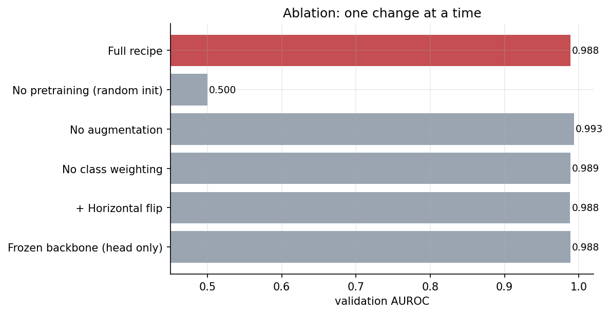

### 8.7 Cost

| Model | Parameters | Size | Training seconds per epoch | Batched ms per image |
|---|---|---|---|---|
| Scratch CNN (reference) | 98,292 | 0.49 MB | 10.0 | 5.0 |
| MobileNetV2 (final) | 2.26 M | 9.6 MB | 9.5 | 40.9 |
| EfficientNetV2B0 | 5.92 M | 24.7 MB | 12.6 | 48.7 |
| ConvNeXtTiny | 27.82 M | 111.8 MB | 54.3 | 81.0 |

The whole four-stage experiment took about 61 minutes on a Colab GPU (20.2 + 16.4 + 11.1 + 13.2 minutes). The single-image latency column in `results/cost_and_capacity.csv` is not used: it ranges up to 2.4 s and looks like warm-up overhead (the notebook's timing code has since been fixed, but the saved file was not regenerated).

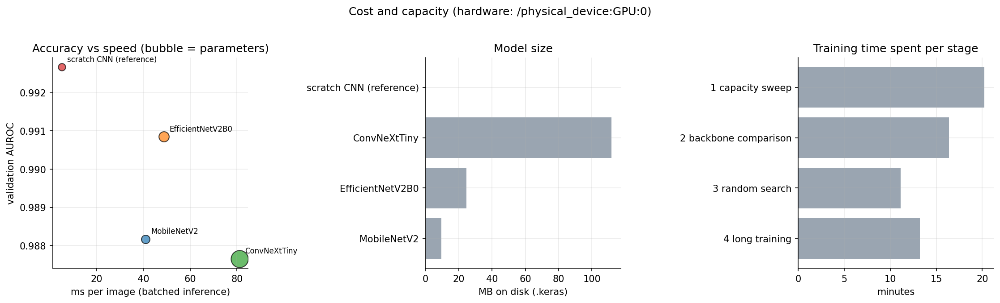

---

## 9. Known issues in the saved outputs

These are defects or weaknesses in the saved files, listed so nobody reads more into them than they support.

| # | Issue | Affects | Effect on the conclusions | Fix |
|---|---|---|---|---|
| 1 | The notebook was changed (commit `8df7a03`) so validation loss uses the same class weights as training loss and a train-vs-validation loss figure (`06b`) was added, **after** the saved outputs were produced. | Figures 06 and 07 loss panels; no `06b` figure yet | The weighted-versus-unweighted loss mismatch makes the training/validation loss gap look larger than it is. AUROC, recall, specificity and the test results are unaffected (loss weights do not change training). | Re-run the notebook on Colab (the test cell reloads the saved scores). |
| 2 | "No pretraining" ablation scored exactly 0.500 AUROC. | Figure 23, `ablation.csv` | Not evidence about pretraining. Two causes together: BatchNorm layers were kept frozen (right for pretrained weights, wrong for random ones), and `keras.applications` BatchNorm uses momentum 0.999, so its running statistics need about 1,000 steps to settle. Frozen, or merely slow to adapt, they stay near their start-up values, the network outputs one constant, and AUROC is exactly 0.5 (reproduced, then fixed, in a small test: 0.5 to 0.93-0.98). | Fixed in the notebook: the variant now trains BatchNorm with momentum 0.9. **Needs a Colab re-run** to regenerate `ablation.csv` and figure 23. |
| 3 | "Frozen backbone (head only)" equals the full recipe. | Figure 23 | Duplicate row; the final recipe is already head-only. | Fixed in the notebook: the row is now "All layers unfrozen". **Needs a Colab re-run** (same run as issue 2). |
| 4 | The single-image latency (up to 2.4 s) in `cost_and_capacity.csv` looks like warm-up overhead. | Cost table | Do not quote it. | Timing code fixed in the notebook (warm-up before timing); the saved file still needs regenerating. |
| 5 | The model was saved with Keras 3.13.2 on Colab; a local environment used 3.15. | Loading `models/deep_learning_final.keras` locally | None. | **Checked:** the file loads under Keras 3.15.1 and scores validation AUROC 0.9922 (recorded 0.9923); no test images were used. |

---

## 10. Limitations

**Data**

- **One hospital, one age group** (children 1 to 5). Nothing here tells how the approaches behave elsewhere.
- **Different test distribution.** The test folder has a different class balance and the network behaves differently on its normals (section 4). Validation numbers should not be trusted as predictions of test performance.
- **Possible patient overlap with the test set.** 170 pneumonia patient numbers occur in both the Kaggle train and test folders. File names cannot show whether these are the same children. If they are, test performance on pneumonia is somewhat optimistic.
- **Normal images have no patient ID**, so one child's normal images may sit on both sides of the train/validation split. Validation, and the threshold chosen on it, are slightly optimistic.
- **Labels** come from the dataset's own physician grading; the project cannot check them.

**Evaluation**

- **One test set, scored once.** A single hold-out of 624 images gives intervals as wide as 0.65 to 0.77 for specificity.
- **The human baseline is one untrained person on 40 images.** It is a rough reference, not a clinical benchmark.
- **The scratch CNN and several candidate models never saw the test set**, so they cannot be ranked there.
- **Threshold chosen once on validation.** There was no second validation set from the test distribution on which to check it.

**Method**

- **Frozen backbone from photographs.** ImageNet contains ordinary photos, not X-rays, and the final model only trains 1,281 numbers on top. A fine-tuned network might behave differently on the shifted test images; the tie rule prevented trying it.
- **Grad-CAM is a sanity check, not proof** of what the model uses.
- **Hand-written rule:** fixed lung boxes and a whole-lung average cannot catch small patchy disease.
- **Staged search:** stages interact and were not checked jointly.
- **Two seeds** is a small sample of run-to-run noise.

**Responsible use.** This is a demonstration project. A tool like this would assist a clinician, who reads the image too; it would not replace one. Its false-alarm rate on healthy children is high, its probabilities are over-confident, and it has not been tested outside one hospital.

---

## 11. What I would do next

In order of how much each would improve what can be claimed:

1. **Re-run the two flawed ablations and refresh figures 06 and 07** (section 9, items 1 to 3). Cheap, and removes the main caveats.
2. **Evaluate on another source.** A second chest X-ray dataset would show whether the shift is specific to this test folder, or a general weakness on healthy children.
3. **Choose the threshold on data that resembles where the model will be used**, not on a slice of the training pool. This needs a validation set from a different source than the training images.
4. **Calibrate.** Fit temperature scaling on validation (it needs only one number) and check whether test calibration improves.
5. **Add the LLM approach** (approach 4) and rerun `eval/eval.py` for all four.
6. **Label more images by hand**, or add a second labeller, so the human comparison has enough images for intervals.
